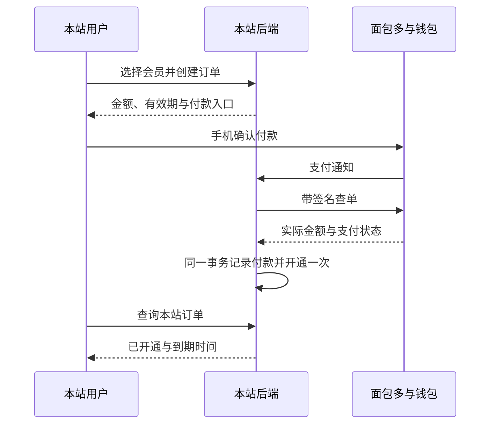

# 面包多 Pay 接入方案

研究日期：2026-10-11。对象：stock.glint.red，当前本地工作区。

本文是接入设计，不代表支付功能已经上线。已核对面包多官方公开接口和项目代码；尚未进入商户控制台验证账号权限，也未进行真实付款、退款或生产部署。下文的本站路由、表结构、状态和重试安排均为拟实现设计。

## 1. 接入结论

采用面包多 Pay 替换新购买入口的爱发电跳转流程。用户在本站选择会员、创建订单、查看付款结果；后端确认收款后自动开通，不再复制账号 ID、填写付款备注或手动认领。

“站内完成购买”可以实现，但微信授权、钱包付款和支付宝收银台仍有外部步骤。不能承诺整个过程始终停留在本站页面。

官方提供微信内支付、手机浏览器微信支付和支付宝移动网页支付。电脑端先显示本站付款页二维码，手机扫码付款，电脑自动更新结果；公开文档未提供可直接采用的 Native 付款二维码接口。[支持方式](https://doc.mbd.pub/untitled)、[支付宝与电脑扫码说明](https://doc.mbd.pub/api/zhi-fu-bao-zhi-fu)

面包多 Pay 面向独立、个体开发者，但需要产品审核和支付渠道审核。开通文档也说明其自 2022 年起控制规模、提高审核要求。因此，不能将“个人开发者可以申请”理解为“无营业执照一定能开通”，也没有足够公开证据证明其当前用户规模。[开通条件](https://doc.mbd.pub/fu-wu-kai-tong)

## 2. 用户付款流程

| 用户所在环境 | 展示与付款方式 | 付款后 |
| --- | --- | --- |
| 电脑浏览器 | 选择微信或支付宝，显示本站付款页二维码 | 原电脑页自动显示开通结果 |
| 微信内浏览器 | 微信支付；经授权获取付款所需 OpenID，唤起微信收银台 | 点击小票页按钮回到本站查看结果 |
| 手机 Safari / Chrome | 已获批的微信 H5；或支付宝移动网页支付 | 返回本站，恢复原订单 |
| 未获批的支付渠道 | 不显示可点击的付款入口 | 已有订单仍可查询和恢复 |

微信 H5 必须先在控制台配置并通过域名审核；JSAPI 支付后的小票页需要用户主动点击按钮返回。以上行为来自平台规则，不能靠前端强行跳转消除。[H5 条件](https://doc.mbd.pub/api/wei-xin-h5-zhi-fu)、[微信付款后返回](https://doc.mbd.pub/learn_more/jsapi-zhi-fu-hou-wen-an)

### 页面内容

付款页只保留会员名称、金额、30 天有效期、支付方式和当前订单状态。普通用户不需要了解接口、渠道流水或回调。

推荐文案：

- `标准版 · ¥9.90 / 30天`
- `微信支付`、`支付宝`
- 电脑：`用微信扫码付款` / `用支付宝扫码付款`
- 付款后尚在核实：`正在确认付款`
- 已收款、开通暂未完成：`付款成功，正在开通`
- 完成：`已开通`，下一行显示到期日期，按钮 `返回监控`
- 取消钱包付款：`未完成付款`，按钮 `继续付款`
- 本站付款入口过期：`付款入口已过期`，提供核实原订单和重新下单入口

显示“已开通”的依据必须是本站已提交的权益记录。钱包返回成功、URL 中的成功参数和用户点击按钮都不能充当开通依据。

电脑扫码不要求手机再登录。二维码绑定当前订单，手机只能支付该笔订单，不能进入电脑账号、查看其邮箱或管理监控。手机付款人可以和本站账号持有人不同；会员始终开通给创建订单的账号。

微信内不强行拉起支付宝；如用户选择支付宝，提供符合实测结果的浏览器打开提示。微信小票返回按钮建议配置为 `返回监控`。

## 3. 价格与会员规则

当前套餐沿用项目定义：

| 套餐 | 价格 | 时长 | 任务数 | 推送配额 |
| --- | ---: | --- | ---: | ---: |
| 标准版 | ¥9.90 | 30 天 | 10 | 100 |
| Pro | ¥19.90 | 30 天 | 30 | 500 |

公开费率是每笔 2% 加 ¥0.10。据此估算，标准版服务费约 ¥0.30、净额约 ¥9.60；Pro 服务费约 ¥0.50、净额约 ¥19.40。实际舍入、退款是否返还服务费须以商户协议和账单为准。[官方费率与结算说明](https://doc.mbd.pub/untitled)

接口金额统一用整数分：990、1990。前端只提交套餐标识，后端读取价格、时长和权益快照；不能接受前端传来的付款金额。商品定义应统一到后端一处，消除 `tiers.py` 与 `pay.py` 的重复价格。

首版是单次购买 30 天，用户主动续费。公开接口没有列出可直接接入的周期自动扣费能力，不应把按钮标成“自动订阅”。

现有权益规则需要明示并完善：

| 行为 | 接入建议 |
| --- | --- |
| 免费或已到期用户购买 | 确认付款后立即开通 30 天 |
| 同档续费 | 从当前有效期末增加 30 天；已到期则从本次开通时间起算 |
| 标准版购买 Pro | 如沿用现有规则，立即升级、保留剩余天数并增加 30 天；付款前展示预计到期日期，不能暗中改变计算方式 |
| Pro 购买标准版 | 到期切换，新增独立的待生效权益记录；完成队列支持前不收这类款项 |
| 同时购买、后台改档 | 按账号串行核算；下单预览与付款后的实际结果均保留记录 |

源码已实现 `pending_tier` 到期后切换并给 30 天，并非完全没有降档承接。但它只有一个档位字段，多笔降档订单无法累计多份时长，因此不能直接用于不限次数的付费降档购买。

另一个独立问题：当前续费把 `quota_reset_at` 一起延长，而 `quota_period_key` 直接使用该日期。提前续费会改变用量所属的周期键，可能立即显示一份空用量，同时推迟下次重置。接入时要把“会员剩余时长”和“30 天配额周期”分开：同档续费延长时长，保留当前周期结束时间；升级提高本周期上限但保留已用次数。不能让多次付款无限重置用量。

退款规则不能从支付平台接口反推。上线前须在购买页附近提供明确的服务与退款条款，再实施对应规则；本文不自行设定无条件退款或不可退款政策。

## 4. 对现有项目的具体改动

| 位置 | 当前情况 | 接入改动 |
| --- | --- | --- |
| `frontend/src/pages/Me.tsx` | 会员弹层关联爱发电，复制账号及检查权益 | 本站下单，进入可恢复的付款页，完成后刷新账号与任务 |
| `frontend/src/main.tsx` | 尚无订单和付款路由 | 增加订单页、扫码付款页与付款返回页 |
| `frontend/src/lib/api.ts` | 主要提供已有付款记录查询 | 增加商品、下单、订单查询、付款准备和结果核实接口 |
| `backend/app/api/routers/pay.py` | 爱发电回调和权益开通；对账仍停留在文档 | 保留旧回调；增加面包多路由，提取平台无关的订单与权益服务 |
| `backend/app/models/models.py` | `Payment` 主要记录回调后的付款，金额为浮点元 | 新增订单、支付尝试、事件任务和权益账本；新金额使用整数分 |
| `backend/app/services/lifecycle.py`、`engine.py`、`api/routers/quota.py` | 到期、配额和任务暂停恢复 | 接入权益队列，调整续费配额锚点，保留用户手动暂停 |
| `backend/app/api/routers/admin.py` | 退款只改本地状态；强制操作可清空所有会员权益 | 区分平台退款和旧单退款标记；只撤销目标订单产生的权益 |
| `admin/src/features/payments/index.tsx` | 付款记录、认领和退款操作 | 增加渠道、开通进度、查单、退款进度与投诉处理 |
| `backend/app/core/config.py`、`backend/app/main.py` | 生产启动强制检查爱发电配置 | 按选定平台检查面包多配置；SMTP 检查保持有效 |
| `deploy/nginx-stock.glint.red.conf` | 自源脚本 CSP，API 统一代理 | 加安全付款桥接、缓存策略与敏感路径日志处理 |

不能把现有 `Payment` 表直接改成待付款订单表。后台收入统计目前以其付款状态为依据，混入未付款订单会影响账目。

## 5. 建议数据结构与本站接口

### 数据结构

| 新对象 | 必要数据与约束 |
| --- | --- |
| `CheckoutOrder` | 随机订单 ID、所属用户、平台、套餐快照、金额分、币种、30 天、创建时间、付款/开通/退款分别记录的状态 |
| `PaymentAttempt` | 所属订单、支付渠道、本站生成的交易号、平台订单号和流水、网关结果、有效期；平台与交易号联合唯一 |
| `PaymentEvent/Job` | 通知摘要、查单任务、重试时间、锁租期、处理结果；写入数据库，重启后可继续 |
| `EntitlementGrant` | 唯一来源订单、授予/排队/撤销状态、实际生效时间、时长和权益计算版本 |
| `RefundRecord` | 所属支付、操作人、原因、平台确认状态、金额分、重试/核实结果 |

使用独立下单幂等键，按用户和请求内容绑定。重复点击返回同一订单；同一个键提交不同套餐应拒绝。现有用于任务创建的幂等记录不应直接混用。

资金状态、开通状态和投诉状态分开记录。例如，钱已经到账但开通失败，应显示“付款成功，正在开通”，后端重试开通；不能要求用户重新付款。

### 本站接口草案

| 接口 | 授权与作用 |
| --- | --- |
| `GET /api/pay/products` | 返回可售套餐和已启用渠道；不含密钥 |
| `POST /api/pay/orders` | 已登录且已验证邮箱；套餐与幂等键；先落库再调用网关 |
| `GET /api/pay/orders/{id}` | 仅订单所属账号；读取本站状态 |
| `POST /api/pay/orders/{id}/prepare` | 所属账号；生成/恢复支付尝试和扫码票据 |
| `POST /api/pay/orders/{id}/reconcile` | 所属账号；限频安排后端核实，不能由请求直接开通 |
| `POST /api/pay/mbd-webhook` | 平台公开回调入口；通知落库，随后查单核实 |
| 扫码票据接口 | 仅该订单的最低必要信息和付款能力，不提供账号权限 |
| `POST /api/admin/payments/{id}/refund-request` | 现有管理员认证；申请真实退款，保留审计 |

前端路由建议：`/checkout/:id` 为账号订单页，`/pay/:ticket` 为手机扫码入口，`/payment-return` 为恢复结果的入口。实际交易号、金额和所属用户全部由后端决定。

用户退出、切换账号或会话失效后，应停止原账号轮询，禁止展示另一账号订单。重新登录原账号后可以继续原订单。

使用 Cookie 的下单与退款请求校验本站 Origin，并按现有认证方式补充 CSRF 防护；扫码付款会话仅能操作已绑定的订单。公共通知入口使用另一套受限处理，不要求用户 Cookie。

## 6. 面包多适配层

所有接口调用由后端完成，`app_key` 只保存在服务器环境变量；不得放进 `VITE_*`、公开配置、网页源代码或日志。

| 能力 | 官方入口 | 本站适配重点 |
| --- | --- | --- |
| 微信 JSAPI | `POST https://newapi.mbd.pub/release/wx` | 后端签名，前端透传返回的六项桥接参数；不硬编码 `signType` |
| 微信 H5 | `POST https://newapi.mbd.pub/release/wx/prepay` | `channel=h5`，由用户点击发起跳转；返回地址和浏览器恢复必须实测 |
| 支付宝 | `POST https://newapi.mbd.pub/release/alipay/pay` | 返回 HTML 表单，不是统一的付款 URL 或二维码字段 |
| 查询 | `POST https://newapi.mbd.pub/release/main/search_order` | 后端带签名调用，校验支付状态、金额、渠道及退款状态 |
| 退款 | `POST https://api.niucodata.com/release/main/refund` | 与其他接口主机不同；实际平台订单号需联调确认 |

接口来源：[微信 JSAPI](https://doc.mbd.pub/api/wei-xin-zhi-fu)、[微信 H5](https://doc.mbd.pub/api/wei-xin-h5-zhi-fu)、[支付宝](https://doc.mbd.pub/api/zhi-fu-bao-zhi-fu)、[查单](https://doc.mbd.pub/api/ding-dan-cha-xun)、[退款](https://doc.mbd.pub/api/tui-kuan)。

### 请求签名

按非空参数名称 ASCII 排序，拼接键值和密钥后取 MD5。官方文字示例中的参数顺序与其规则矛盾，而 Python/PHP 示例实际进行了排序。实现按规则和代码示例处理，并用真实请求对拍中文描述、空值及 URL 参数。[签名文档](https://doc.mbd.pub/api/qian-ming-suan-fa)

这套请求签名不能直接当成通知验签：公开通知文档没有给出回调签名字段、签名头或完整验签协议。若平台补充正式回调验签规范，再按该规范加验签。

### 微信授权与跨设备票据

JSAPI 需要先经 `https://p.mbd.pub/openid` 获取付款 OpenID，再返回本站。[OpenID 流程](https://doc.mbd.pub/api/huo-qu-yong-hu-openid)

本站使用短时、随机、一次兑换的支付票据；兑换后发放仅供该订单付款的会话。授权返回附带独立的一次性 `state`，绑定订单和渠道。OpenID 只用于付款，不能替代本站登录，也不能据查询参数中的用户 ID 改变权益归属。

票据在数据库保存摘要，限制有效期和兑换次数；返回地址固定在本站受控路径。付款页不加载分析脚本，日志不记录完整票据、OpenID 或支付表单。手机支付会话可在有限时间内恢复，避免授权返回就失效。

### 支付宝桥接与 CSP

不能把官方返回的整段 HTML/脚本直接塞入 React 页面，也不应为此全站开放内联脚本。项目已有自源脚本 CSP。

后端解析返回表单，校验 HTTPS 官方支付宝网关主机、路径和 POST 方法，安全转义字段并重建表单；同源的独立脚本提交表单。限制表单大小、重复字段和非法标签，遇到未知网关先拒绝并记录可排查摘要。单独设置桥接页 CSP，不执行平台返回的任意脚本。

微信 H5 的 Referer 要求须真实联调。支付跳转经不含票据的同源桥接路径，保留支付所需本站来源信息，避免将敏感票据带给外部。不能简单对所有付款页面使用 `no-referrer` 后就宣称兼容 H5。

## 7. 收款、开通与异常恢复

通知文档说明会重复推送付款和投诉事件，但没有完整列出验签、确认响应和重试协议。面包多查单文档明确要求前端查询商户自己的订单，禁止高频查询平台。[通知说明](https://doc.mbd.pub/api/webhook-yi-bu-tong-zhi)、[查询与频率要求](https://doc.mbd.pub/api/ding-dan-cha-xun)

接入采用以下规则：

1. 通知必须能关联本站已有订单；未知订单不触发外部请求，也不创建会员。
2. 通知写入持久队列后按平台已确认的协议响应；进程内临时任务不能承担唯一开通链路。
3. 工作者针对该交易号带签名查单，核对本地金额、渠道、支付状态与退款状态。平台订单号与本站交易号的映射要经联调确认，不能假设字段相同。
4. 明确已付或已结算且无退款、金额一致时，才首次开通。投诉状态进入人工处理，不能用 `state > 0` 统一判定可开通。
5. 付款记录、唯一权益授予与会员更新在同一数据库事务提交。不同订单对同一账号的更新要串行，重复通知、查单和用户刷新只能授予一次。
6. 查单超时只表示结果未知；保留待核实状态并退避重试。回调丢失由低频对账恢复，开通失败由持久任务恢复。

平台网络请求放在数据库写事务之外，避免查单超时长时间占用 SQLite 写锁。数据库只在落订单、领取工作和提交开通结果时使用短事务；提交时重新检查订单及用户版本。

拟定前端查询本站的间隔：开始约 3 秒，等待较长后放缓至 5–10 秒；后台标签暂停轮询，返回前台立即读取状态。该间隔是本站设计，不是平台公布的配额。后端按交易号合并查单任务、限频与退避，不能让每个前端轮询都打到面包多。

当前全 API 共用 IP 限流。付款通知须使用独立、受限的处理通道，避免同一平台出口 IP 的正常通知被批量挡住；仍保留请求体大小限制、无效请求限制及查单限流。

### 必须覆盖的异常

| 异常 | 处理 |
| --- | --- |
| 下单请求超时 | 重试同一幂等键，返回原订单 |
| 网关创建超时 | 先核实原交易号；不立即用新交易号再创建一笔 |
| 重复点击或多个标签页 | 恢复同一待付款订单；同一订单只允许一个活动支付尝试 |
| 切换微信与支付宝 | 核实/关闭原尝试；平台未确认支持关闭前，不能并行产生两笔可付订单 |
| 本站倒计时结束后实际付款 | 继续核实、开通或进入退款处理；不能因本地过期就忽略真实收款 |
| 重复实际扣款 | 保留两笔资金记录，权益只授予一次，多收的一笔进入退款处理 |
| 用户未返回本站 | 后端仍开通；下次访问读取真实权益 |
| 金额异常、部分退款、投诉 | 不自动授予新权益，后台显示待处理；不静默清空已有权益 |

公开接口没有列出关闭交易能力。因此本地“过期”只控制付款入口，不等同于平台已关闭收款。支付尝试失效、关闭与幂等能力都须在联调中确认。

## 8. 退款和后台

官方退款接口未列出金额参数，首版只按已公开的整笔退款设计；余额不足会导致失败。部分退款和结算后的资金安排不能自行假设。[退款条件](https://doc.mbd.pub/api/tui-kuan)

本站流程为：管理员查看影响 → 提交退款申请 → 后端调用平台 → 核实退款状态 → 撤销对应订单权益 → 更新任务与配额。接口超时保留“退款核实中”，先查状态，不盲目重复退款。

现有 `refund_payment` 仅把本地记录改为已退款，并可能将用户全部降为免费版。该路径不能承接新平台的真实退款。旧爱发电订单保留独立的人工退款标记入口，明确表示它不负责退回资金。

新权益账本记录开通、续费、升级和待生效切换。退款时按原生效时间及计算版本重算，保留其他订单及管理员赠送的权益；升级影响原有剩余时长也须记录，不能只粗略减 30 天。切换时为旧会员建立可追溯基线，不能从当前到期时间猜测历史购买。无法可靠拆分的旧单进入人工处理，不强制清空会员。

后台区分“已付款”“已结算”“开通待重试”“退款处理中”“已退款”“投诉处理中”。收入、退款和平台结算分别统计；付款成功不能直接显示成银行已到账。投诉只进入工单处理，不自动等同退款。

## 9. 开通材料与待确认事项

按官方步骤注册，提交闪电认证申请并选择仅开通闪电结算，再申请支付渠道。产品描述应如实说明服务内容和价格。[申请说明](https://doc.mbd.pub/fu-wu-kai-tong)、[申请入口](https://mbd.pub/o/warrant)

可用于申请的描述草稿：

> StockMon（stock.glint.red）提供 Apple 官方零售店商品库存查询与到货提醒。用户选择商品规格和门店，在网页查看库存，并通过邮件接收到货提醒。付费会员购买更高的监控任务和通知额度：标准版 9.90 元/30 天，Pro 19.90 元/30 天。本站不销售或代购 Apple 商品。提供订单查询、服务说明和售后联系方式。

上线前需要得到实际商户配置或平台确认：

1. 该个人主体与服务类别是否通过审核；本站域名、H5 域名和相关备案要求。
2. 两个支付渠道的实际权限，以及生产 `app_id`、`app_key`。密钥只填服务器环境变量，不粘贴到公开文档。
3. 通知验签规范、确认响应格式、重试计划和当前出口 IP。公开白名单页带有 2021 年更新信息，不应直接视作完整现行名单。[白名单文档](https://doc.mbd.pub/api/ip-bai-ming-dan)
4. 交易号长度、字符集、重复创建是否幂等、付款有效期、是否支持关闭交易。
5. 支付宝 `url` 与 `callback_url` 的实际作用，查单返回的 `order_id` 对应关系及退款主机是否仍为公开文档地址。
6. 退款状态的最终确认方法、结算后退款与服务费处理。

这些是开通和实款验收条件，不阻碍先完成本地开发与模拟测试。不能在未确认时编造接口字段、回调验签或成功响应。

## 10. 实施与验收顺序

1. **订单底座**：统一商品金额，增加表和 Alembic 迁移、订单幂等、权益账本与配额规则；用隔离数据库验证迁移和历史会员基线。
2. **平台适配**：签名、请求超时、微信与支付宝付款准备、带签名查单、持久任务和整笔退款；通过模拟网关验证故障恢复。
3. **前台与后台**：替换新购买入口，增加跨设备付款页、结果恢复及退款状态；本地预览明确标注模拟结果，模拟能力不能进入生产。
4. **商户联调**：获批 HTTPS 环境核验真实响应和渠道权限。localhost 不能作为平台公开回调地址；在 iPhone Safari、安卓 Chrome、微信内和电脑扫码上验收。
5. **生产切换**：备份、迁移、配置校验、付款开关和监控完成后切换入口。继续接收旧爱发电订单，不让新旧平台重复授予同一份权益。

建议配置为 `PAYMENT_PROVIDER=mbd`、独立购买开关和渠道开关。退款权限、密钥及签名都在后端；未配置或渠道未审核时提供明确的暂不可购买状态，不能静默跳回旧支付渠道。

| 验收项 | 必须得到的结果 |
| --- | --- |
| 下单与回调重复、回调并发 | 一笔真实付款只开通一次 |
| 不同订单并发续费 | 时长准确累计，不丢一单 |
| 伪造成功通知、错金额、改用户或套餐 | 不开通、不改账号归属 |
| 通知丢失、查单失败、服务重启 | 订单可恢复，已付款用户无需再次支付 |
| 跨设备、浏览器返回、刷新、换账号 | 手机无需登录；原账号可恢复，其他账号看不到订单 |
| 到期、提前续费、升级、待生效切换 | 日期和配额与购买说明一致，手动暂停任务不被误恢复 |
| 钱包取消、本地过期后付款、双渠道操作 | 不误报失败，不忽略到账，不重复收款 |
| 单笔与多笔会员退款、退款超时、余额不足 | 资金结果可核实，只撤销对应权益，不误伤其他购买 |
| CSP 与敏感信息 | 微信/支付宝能付款，源码和日志无密钥、完整票据 |
| 旧爱发电会员及延迟回调 | 权益、订单与后台记录继续有效 |

本轮完成公开资料核对与代码映射。上述验收是后续开发和联调清单，尚未执行，不应据此宣称支付已接通。
