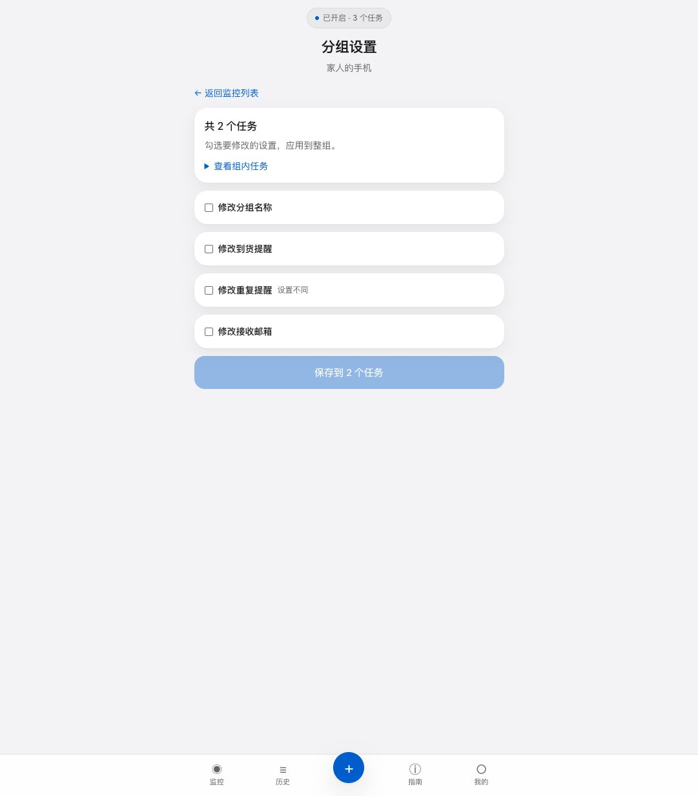
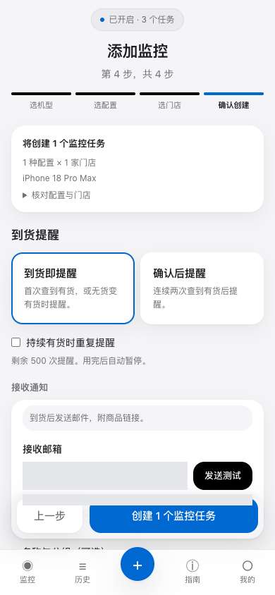
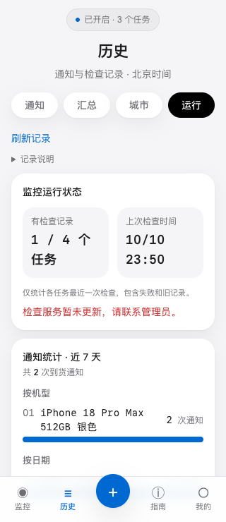

# stock.glint.red 产品体验与修复报告

日期：2026-10-10；修复更新：2026-10-11。对象：生产站点和本地修复版本。视角：首次用户、长期用户和挑剔的产品经理。

## 最新修复：2026-10-11 Safari 与库存链路回归

本节为当前结论。此前真机审计列出的 **14 项问题均已修改**，包括第四项任务卡信息重复和截断。本节修复已于北京时间 2026-10-12 随 `bf82ffa` 提交、同步 GitHub 并部署，发布检查见 [2026-10-12 生产发布记录](release-2026-10-12.md)。下文历次“尚未部署”记录保留为当时的验收边界。保留现有 Logo、favicon、开屏动画和审核账号；无需数据库结构迁移。

### 问题与修复结果

| 审计问题 | 当前行为与证据 |
| --- | --- |
| Safari 聚焦输入后自动放大、持续裁切 | 移动端文本输入／选择框／文本域至少 16px，保留主动缩放。真机搜索“杭州”、收起键盘、继续确认及创建；任务名输入“Safari 回归”、收起键盘、保存、返回首页均保持 393 点网页宽度。其他表单的计算字号由 Chrome 验证。 |
| 删除遮罩局限于任务卡 | 弹窗通过 portal 挂到 body，背景 root inert、锁滚动、取消优先焦点、Tab 留在弹窗、Esc／取消恢复入口。真机截图覆盖整个网页及底部导航，AX 只暴露弹窗和 Safari 控件；取消后任务保留。 |
| 首屏重复顶栏和过大留白 | Logo 与任务状态同排，去掉旧固定状态占位；向导只保留当前步骤。手机首屏可看到两种机型；Logo 未替换。 |
| 默认标题重复 SKU，门店被截断 | 默认任务分为机型标题、容量／颜色和实际门店名；自定义名称保留并可换行。单门店直接显示名称；真机首页核对配置与 Apple 西湖。 |
| 24 小时任务刚创建就强调续期 | 体验任务最后 3 小时才提示续期，30 天任务最后 3 天提示；未到期按钮使用普通样式。短期任务显示小时，修复刚创建被取整为“2 天”；真机当前显示“剩余 23 小时”。 |
| 暂停文案重复 | 首页手动暂停只保留状态徽章和恢复操作；详情单门店不再重复汇总及行内状态，多门店不在各行重复整组健康提示。额度／邮件失败等自动暂停原因仍显示。 |
| 没有时间却留下“查询于” | 无记录显示“尚未检查”；查询时间明确为尝试时间，不冒充有效库存更新时间。真机与浏览器均核对。 |
| 匿名历史出现未登录错误，同时声称无记录 | 匿名只显示登录入口，不请求需认证的通知接口；接口失败显示重试，不能当空历史。浏览器监测匿名无认证请求，并用 500 fixture 验证错误与空状态互斥。 |
| 匿名通知区保留不可用控件 | 匿名只显示站内提醒说明和登录接收邮件入口，没有禁用邮箱／发送测试按钮。 |
| 已查询但库存仍未知 | 保留三态判定，新增原因；`ineligible` 显示“自提未开放”，缺失／异常结果有对应解释。详情摘要与门店列表取同一响应，并提供就近 Apple 核实／购买入口。详见下节。 |
| 体验任务转入账号仍次日到期 | 登录转入时，有限期任务延长至至少 30 天；保留更长期限和手动暂停，重复登录不重复延长。实际数据库回归通过，成功提示说明期限。 |
| 会员价格“天”孤字换行 | 金额与“30 天”分行，短语不拆开；去掉重复 PRO 标签，CTA 精简为“开通”。320／375／393／430／1280 宽度价格不裁切、页面无横向溢出。 |
| 复制反馈远离按钮 | 成功直接显示在 ID 按钮旁，3 秒后撤下；开通弹窗内也有反馈，失败给就近可手动复制的 ID。真实浏览器剪贴板操作和取消流程通过，未付款。 |
| 周期和通知正文难理解 | 300 秒改为每 5 分钟；到期通知去掉原始 SKU 和冗长说明，保留时间与续期动作。指南去掉重复取货步骤。 |

### 库存未知：根因与稳定处理

此前生产实测 `MK2M4CH/A` 返回 `pickupDisplay=ineligible`、`storePickEligible=true`，因此接口能够成功查询，但没有可判断的自提库存。[Apple 当前购买页](https://www.apple.com.cn/shop/buy-iphone/iphone-duo)仍显示后续预购／发售安排；它支持“自提未开放”的解释，不能把这个结果改成无货，也不能只凭目录里有商品编号宣称可查到有效库存。目录文案现为“可添加／待补齐”，不硬编码发售日期。

同时发现并修复了独立的代码缺陷：

- **解析与备用接口：** 校验 body、stores、商品字段；字符串“false”不能作为 true，异常库存／说明形态不能进入数据库。空结果／缺字段不当作查询成功，自动尝试备用接口补齐缺失门店；保留真实部分结果，不用其他门店冒充所选门店。合法 `ineligible` 不会为了强行得出有货／无货而增加查询。
- **分批完整性：** 一轮中先失败、后成功不能把任务 `last_poll_ok` 覆盖为 true；缺少任一所需门店字段，本轮保持不完整。此前成功标记可能掩盖实际失败，新增数据库回归覆盖。
- **归属隔离：** 同城市同商品合并查询时，每个任务只写自己的门店；不写其他任务的门店结果或检查时间。查询失败清理旧原始字段，保留通知基线，避免伪造库存变化或重复通知。
- **限流与快照：** 主接口触发限流、备用接口普通失败时仍保持退避；详情摘要与门店列表使用同一个 Task.latest，避免两次请求跨越轮询产生相反状态。

稳定性目标是避免把空响应当成功、把失败覆盖、把未知冒充无货，以及不给用户解释。Apple 不提供库存、网络失败和限流仍可能出现；页面必须准确说明，不能承诺第三方库存永远已知。部分有货与未知混合时只提示“部分门店库存未确认”，不暗示所有门店都无法自提；不同未知原因混合时逐店解释，不伪称都缺字段。本轮没有触发真实到货或伪造生产结果。

### 验收环境、结果与证据

- **环境：** Chrome 本地 `http://127.0.0.1:5173`，真实本地后端、隔离数据库，320–1280 像素；真实 iPhone 15 Pro／iOS 27.2／Safari 使用同一开发版本 `http://192.168.1.44:5173`，393×852 点。本地引擎、SMTP 关闭，不发送真实通知。Browser plugin not available（本轮没有列出 browser skill），按 frontend-testing-debugging 使用已有 Playwright／Chrome，不安装新依赖。
- **代码检查：** 后端全量 **239 项通过**，本轮新增库存／调度／转入回归 **24 项**；Ruff 通过。前端 `npm test` **13 项通过**，TypeScript、生产构建通过。7 个后端依赖弃用警告已存在，不冒称无警告。
- **交互：** Chrome 匿名创建／暂停／删除取消／详情等首段 **21 条**通过；账号剪贴板／会员取消／价格断行／库存原因／同快照／失败历史等终段 **23 条**通过；多门店有货／未知混合及不同未知原因专项 **2 条**通过。页面身份、非空、无框架遮罩、无未处理 JS 异常、截图及实际控件结果均核对；控制台 error 仅为匿名身份确认的预期 401 和通知失败 fixture 的 500。首段曾因复制回调尚未完成中止；账号段旧定位器命中 inert 背景按钮曾中止，按弹窗范围修正后通过，不把这些定位问题计为产品缺陷。
- **真机：** 搜索 → 收键盘 → 确认 → 创建一次最小任务 → 暂停；详情名称输入 → 收键盘 → 保存成功 → 首页核对；删除 → 全网页遮罩 → 取消保留。测试任务保持暂停。某次通道读取超时后复用正在运行的服务恢复，没有重放不确定的提交。
- **边界：** 本轮手机为本地匿名态；会员及登录后新版样式用 Chrome 真实本地账号验收。旧版生产注册、登录及测试邮件收件见历史真机记录。库存原因与 500 为明确的响应 fixture，生产 `ineligible` 根因来自此前真实响应；没有新生产写入、付款、退款、永久删除、真实密码变更或屏幕阅读器测试。逐轮检查日志、整组替换商品／门店属于未实现扩展，不混称本次缺陷修复。

证据文件：`/tmp/sm-audit/safari-fix-ui-evidence.json`、`safari-fix-ui-account-evidence.json`、`safari-fix-partial-ui-evidence.json`。以下原始真机截图不含密码、验证码或账号邮箱；页面右边熊猫浮层来自设备上的其他应用，不属于网站。

- [搜索输入与键盘](/Users/youfei/.local/share/iphone-use/artifacts/20261011T104528956966Z-9d7662a8.jpg)
- [收键盘后确认页宽度正常](/Users/youfei/.local/share/iphone-use/artifacts/20261011T104541615535Z-61c2aa0a.jpg)
- [名称输入后的页面](/Users/youfei/.local/share/iphone-use/artifacts/20261011T105317686827Z-7a93c080.jpg)
- [保存后首页与小时期限](/Users/youfei/.local/share/iphone-use/artifacts/20261011T105507852240Z-a21f074e.jpg)
- [修复后的全网页删除遮罩](/Users/youfei/.local/share/iphone-use/artifacts/20261011T105535588948Z-6543bb02.jpg)
- [手机价格排版](/tmp/sm-audit/safari-fix-mobile-plans.png)
- [手机自提未开放解释](/tmp/sm-audit/safari-fix-mobile-stock-not-offered.png)
- [桌面账号及就近复制反馈（邮箱已遮盖）](/tmp/sm-audit/safari-fix-desktop-me.png)
- [最终真机详情及 Apple 核实入口](/Users/youfei/.local/share/iphone-use/artifacts/20261011T110549651152Z-57b38d04.jpg)

## 上一次发布状态：2026-10-11

截至该次发布的修复已随提交 `fde8cd2ae2ae93ae5dd1ba756c815ad36fa39d77` 同步到 GitHub master 并部署至生产。下文历次记录中的“尚未部署”描述的是当时状态，不代表当前发布状态。

发布合并保留了线上新增的 Logo、favicon 和开屏动画。发布前后端全量 215 项测试、前端构建及 7 项针对性检查、管理员前端构建通过；发布后公网 HTML、JS 和 CSS 与本地构建一致，API 和监控引擎运行，健康检查确认数据库可用。部署前已备份运行文件、配置和 SQLite 数据库。

真机免费账号主流程已补测：iPhone-use 0.3.10 已安装，真实 Safari 已完成注册验邮、登录、匿名任务转入、会话刷新保留、任务编辑、整组暂停恢复、组名修改、续期、测试邮件实际收取、四个历史标签及会员开通前确认。测试任务最终保持暂停。发现 Safari 自动放大、删除弹窗遮罩、未知库存解释和版式等新问题；当时这些新问题尚未修复；下方历史记录保留复现过程，最新修复结果见本文开头。付费成功、真实到货变化和屏幕阅读器仍未验收。详细记录见下节。

## 2026-10-11 Safari 真机验收（免费账号主流程已补测）

设备为真实 iPhone 15 Pro，iOS 27.2，Safari，视口 393×852 点；测试生产发布 `fde8cd2`。手机首次恢复了旧版页面，正常刷新后加载新版 Logo 与文案；不能把旧页面缓存误判成发布遗漏 Logo。一次 USB 中断后，重新连接数据线即恢复同一服务，未重装或重复提交任务。

### 实际操作与结果

| 路径 | 真机结果 | 边界 |
| --- | --- | --- |
| 匿名添加四步 | 选择 iPhone Duo；全选 8 个可监控配置时被名额限制阻止；清空后选 256GB／星光白色／Apple 西湖，核对并创建 1 个任务 | 仅创建一个测试任务，未操作其他用户数据 |
| 门店搜索与软键盘 | 搜索“杭州”正确筛出门店；收起键盘后仍保持自动放大，内容裁切延续到确认页和首页 | 真实 Safari 缺陷，Chrome 模拟窄屏不能覆盖 |
| 暂停／恢复／刷新 | 暂停状态可见；完整刷新保留任务；恢复后出现暂停按钮，顶部显示已开启 | 证明操作和状态保留，不证明 Apple 已返回有效库存 |
| 详情与编辑 | 购买目标、门店、创建时间可见；任务名改为“真机测试”，保存显示“任务设置已保存”，返回首页保留新名称 | 任务名输入也触发自动放大；未改变 SKU、门店或通知策略 |
| 删除确认 | 可打开确认，说明无法恢复；点击取消后任务仍在 | 未执行永久删除；遮罩只覆盖卡片，属新缺陷 |
| 匿名历史／我的 | 匿名访问显示登录入口和任务转入账号说明；历史四标签禁用 | 登录后的结果单独记录，不以匿名提示替代 |
| 指南 | 四条购买说明及末尾提示可读，底部导航可达 | 指南没有实际商品直达入口；未下单 |
| 登录空表单与注册验邮 | 空提交提示“请填写邮箱和密码”；使用 smail.pw 临时邮箱，用户亲自设置密码并提交后进入验证页，显示发送提示及重发倒计时；同一收件箱实际收到验证邮件，按用户明确指示使用验证码后网站显示“验证成功，请登录” | 密码、邮箱、验证码不写入报告；验证码过期及重发最终收取另有早期 Chrome 记录，不混为本次真机通过 |
| 登录与会话 | 用户亲自输入密码登录后出现“已认领 1 个匿名任务”；完整重新载入后账号仍登录，任务名与暂停状态保留 | 转入任务仍保留原 24 小时期限；本轮未退出后再次要求用户登录 |
| 真实检查 | 恢复同一个任务，18:14 得到真实 Apple 查询记录；页面刷新后出现对应时间，运行页可展开检查记录 | 请求成功不等于有效库存：Apple 返回 `pickupDisplay=ineligible`，任务为未知，当前有效结果为 0/1 门店；未制造有货／无货数据 |
| 邮件测试 | 在详情点击一次“发送测试”，出现已发送反馈；同一 smail.pw 收件箱实际收到 StockMon 测试邮件；账号通知历史显示“已发送” | 证明这一次实际收取，不代表所有邮件有投递回执；测试记录在账号历史，任务专属历史仍为空；未修改收件地址 |
| 分组编辑与暂停恢复 | 新增分组；进入分组设置时默认没有勾选字段、保存禁用；只勾选组名并改为“真机验收”，保存后数据库一致；整组恢复与暂停各有结果提示和实际状态 | 仅操作本人单任务组；成员冲突、多任务组和其他提醒字段保持早期本地验收边界 |
| 登录后历史四标签 | 通知／城市分别显示近 30 天／近 24 小时无到货通知；汇总显示免费版权限说明，文字可读；运行显示真实检查时间，展开后显示有效结果 0/1 门店 | 空通知不等于门店无货；生产付费汇总和有到货记录的图表未覆盖 |
| 我的与通知历史 | 免费版任务 1/3、提醒 0/5，暂停任务仍占名额；默认邮箱已配置、近 7 天发送成功 1 次；测试邮件及到期站内通知可见 | 邮件健康只说明发送记录；新增的 24 小时任务立即收到剩余 1 天提醒，见下方缺陷 |
| 会员开通前路径 | 查看 Pro ¥19.9／30 天、标准 ¥9.9／30 天及免费版权益；两种付费卡均打开对应金额的“核对开通信息”，取消正常返回；复制 ID 后下方付款区出现反馈；检查开通结果返回免费版；付费记录为空，退款说明可展开 | 未前往外站付款、未支付或退款；复制提示已出现，未读取系统剪贴板验证内容；改密入口可见，未展开或提交凭据 |
| 续期 | 在已暂停的本人任务点击一次“续期（+30 天）”，剩余 1 天变为 31 天；数据库到期时间增加 30 天，为北京时间 2026-11-11 17:58:55 | 暂停状态保持；未付款，也未因此自动恢复监控 |

测试任务最终已暂停并保留，手机仍保持测试账号登录。没有付款、退款、永久删除或真实改密；邮件测试只发往本次注册的临时收件箱。工具对某些点击返回成功时，页面仍未切换；按截图和后续真实状态定位，不将工具返回值当作业务通过证据，也未因读取超时重放创建、保存或发送。

### 新问题与修复顺序

| 优先级 | 真机问题 | 原因／下一步 | 验收标准 |
| --- | --- | --- | --- |
| P1 | 搜索／任务名聚焦使页面自动放大，收起键盘后左右裁切；右侧导航及文字可能超出屏幕 | 门店搜索显式 `text-sm`，编辑输入继承 14px 标签字号。移动端文本输入、选择框、文本域至少 16px；同时核对键盘与固定导航占位，保留用户主动缩放 | 门店搜索、名称、邮箱、重复间隔均能输入；键盘出现／收起后无需重新加载即可完整看见正文与导航 |
| P1 | 删除弹窗遮罩仅覆盖任务卡片，页头和底部导航仍露在外面 | `ConfirmDialog` 在带 `rise-in` 的 Card 内渲染，动画最终保留 `transform: translateY(0)`，形成 fixed 包含块。弹窗应挂到页面顶层，统一阻止背景交互并恢复焦点 | 普通及放大视口均全屏遮罩；背景不能操作，取消恢复原入口，未确认不删除 |
| P2 | 首屏留白和重复顶栏占据大量空间，向导初次进入要滚动才能看见机型 | Logo、状态胶囊、匿名横幅、页标题和步骤提示叠加。保留 Logo，压缩状态区／间距；同一事实只出现一次，向导优先展示当前选择 | 常用手机首屏能看到当前选择与下一步；状态不抢占操作区域 |
| P2 | 默认任务名重复 SKU 且截断门店；自定义名称后首页只有门店数量，没有门店名称 | 标题／SKU／门店应各承担一个信息职责；单门店直接显示名称，多门店可展开列表 | 用户无需进入详情就能回答“哪款、哪种配置、哪家店” |
| P2 | 新建 24 小时体验任务立即出现蓝色整行续期，并把剩余 1 天标红 | 统一 3 天阈值让所有体验任务从创建起就进入紧急续期样式。按任务周期设置到期提示；主操作随运行／暂停／到期状态变化 | 新任务不会误显紧急状态；暂停任务的主要恢复入口清楚，到期后才突出续期 |
| P2 | 暂停卡片连续写“已暂停”“已停止检查”“已暂停检查” | 徽章与检查健康重复。保留一个状态和确有必要的时间／原因 | 一次扫读能明白当前状态，不用读三个同义句 |
| P2 | 尚无门店检查时间，却显示单独“查询于” | `TaskDetail` 无时间分支返回空串但仍渲染前缀。改为“尚未检查”，或完整隐藏时间行 | 无时间时不留下残句；有时间时呈现真实记录年龄 |
| P2 | 匿名详情通知历史显示红色“未登录”，同时又显示“暂无通知记录” | `NotificationHistory` 对 401 置空数组后仍渲染空状态，且匿名详情仍请求需认证接口。按身份区分登录提示、真实空记录、加载失败 | 匿名提示可登录且不标为监控错误；失败不冒充无记录，登录后可重试 |
| P2 | 匿名通知区域反复说明登录后邮件，并保留禁用邮箱和测试按钮 | 展示用户当下能执行的操作；匿名只保留站内通知说明和一个登录入口，旧配置兼容另处理 | 用户能明确通知在哪里看，不需要理解一组不可用控件 |
| P1 | 目录称配置可监控，但真实 Apple 返回 `ineligible`；检查时间更新，库存持续未知 | 当前三态分类正确地保留未知，但没有解释已查询却无有效库存。分开呈现最近尝试和有效库存，说明“Apple 未提供可判断的自提库存”；复核目录的可监控依据。不能未经验证把 `ineligible` 映射为无货 | 最近查询成功但有效覆盖为 0 时，用户能知道库存仍未确认，且看得到核实入口；不展示有货或无货推断 |
| P2 | 登录提示只有转入数量，未说明体验任务仍会在次日到期 | 明确任务已转入账号及原到期时间；是否自动延长作为明确产品规则实现，不能只改提示。沿用期限时提供就近续期动作 | 用户能知道登录是否延长监控、何时停止；与实际到期字段一致 |
| P2 | Pro 金额把“天”单独换到下一行，两张价格卡无法快速比较 | 手机两列空间不足；价格和周期拆成独立层级，周期短语整体排版。去掉 Pro／PRO 重复标签及“点击前往”等多余动作词 | 320–430 宽度下价格完整、周期不孤字断行，套餐可直接比较 |
| P2 | 复制用户 ID 的提示位于远处“已付款？”区域，点击时看不到 | 操作反馈跟随入口；按钮改为短时“已复制”，弹窗内也显示反馈，不覆盖付款查询结果 | 不滚动即可看到复制结果，重复点击没有必要 |
| P3 | 账号检查周期为“300 秒”，通知正文出现原始 SKU 和冗长到期操作说明 | 用“每 5 分钟检查”；通知标题表达事件，正文优先到期时间和任务入口，机型配置代替内部编号；按需展开细节 | 用户可直接读懂周期和需要做的事，不需要自行换算或识别 SKU |

首次检查未出现已完成服务器排查：生产 `stockmon-engine` 在北京时间 12:57 收到正常停止指令；API 仍运行。它在本次 17:47 创建测试任务时确实未运行。停止来源未确定，不认定为代码崩溃。经用户明确允许，于 18:05 恢复引擎；随后短时恢复同一测试任务，18:14:12 写入真实查询时间、成功标记及未知结果。18:27 测整组恢复时再次实际查询；随后整组暂停，数据库确认 `paused=1`。最终公网 `/healthz` 返回数据库正常、引擎运行。后续运行保障应同时覆盖 API 和引擎心跳，不能仅用网站可打开判断监控正常；停止来源仍待核实。

版式改进参考用户 Obsidian 收藏“Apple官网排版细节鉴赏-2026-10-06”：明确文字层级、短语断行和中英文排版，避免重复说明。保留现有 Logo 与系统字体；不引入 Apple 私有字体或强制阻止缩放。

### 原始截图

截图是设备工具直接保存的原始 JPEG，未裁切或修改。以下不含密码、验证码或账号邮箱：

- [新版首页](/Users/youfei/.local/share/iphone-use/artifacts/20261011T094313093216Z-64251cb7.jpg)
- [全选配置触发名额限制](/Users/youfei/.local/share/iphone-use/artifacts/20261011T094441158284Z-3ad2e6c5.jpg)
- [门店搜索收起键盘后仍裁切](/Users/youfei/.local/share/iphone-use/artifacts/20261011T094549194480Z-df4cbcd6.jpg)
- [正常视口中的任务卡片](/Users/youfei/.local/share/iphone-use/artifacts/20261011T094952171377Z-374d7dd9.jpg)
- [详情缺失查询时间与匿名历史错误](/Users/youfei/.local/share/iphone-use/artifacts/20261011T095604532372Z-0b5463d5.jpg)
- [编辑名称收起键盘后仍放大](/Users/youfei/.local/share/iphone-use/artifacts/20261011T095656765734Z-928b73c2.jpg)
- [保存成功](/Users/youfei/.local/share/iphone-use/artifacts/20261011T095754044414Z-21027b73.jpg)
- [删除确认遮罩局限于卡片](/Users/youfei/.local/share/iphone-use/artifacts/20261011T095828624593Z-b255dc95.jpg)
- [取消后保留暂停任务](/Users/youfei/.local/share/iphone-use/artifacts/20261011T095855841510Z-5ab2d25c.jpg)
- [匿名历史登录提示](/Users/youfei/.local/share/iphone-use/artifacts/20261011T095923903675Z-8ae951aa.jpg)
- [购买指南](/Users/youfei/.local/share/iphone-use/artifacts/20261011T095959102369Z-9d192e25.jpg)
- [登录空表单错误提示](/Users/youfei/.local/share/iphone-use/artifacts/20261011T100042902887Z-23d5e717.jpg)
- [登录后分组与未知库存](/Users/youfei/.local/share/iphone-use/artifacts/20261011T101736406620Z-edfe6885.jpg)
- [免费版汇总权限提示](/Users/youfei/.local/share/iphone-use/artifacts/20261011T101959391226Z-34a52e4a.jpg)
- [运行页展开后的有效结果覆盖](/Users/youfei/.local/share/iphone-use/artifacts/20261011T102122988200Z-814f6463.jpg)
- [会员价格在手机上的断行](/Users/youfei/.local/share/iphone-use/artifacts/20261011T102542234417Z-2a1bdd9e.jpg)
- [Pro 开通前确认](/Users/youfei/.local/share/iphone-use/artifacts/20261011T102553557331Z-bef4b055.jpg)
- [权益检查与付费记录空状态](/Users/youfei/.local/share/iphone-use/artifacts/20261011T102637719076Z-d31b3af2.jpg)
- [续期后任务仍暂停](/Users/youfei/.local/share/iphone-use/artifacts/20261011T102717191942Z-8723a01a.jpg)

剩余验收范围：上述新问题修复后的 Safari 回归；登录后批量新建、多个成员的分组编辑与冲突、修改接收地址和不同通知策略、真实到货与重复提醒、生产密码恢复与实际改密、付费开通／回调／退款、生产付费有数据历史及屏幕阅读器。没有执行永久删除。本轮只创建一个测试任务，未通过增加真实订单或伪造库存填补边界；此前 Chrome／本地 API 结果与本节真机证据分开。

### 下一轮修复验收顺序

1. 先修 Safari 表单字号、全屏弹窗和查询成功但库存未知的解释，使用同一台手机复测输入、键盘收起、导航、取消与有效覆盖。
2. 再整理首屏层级、任务卡信息、到期提示及任务转入后的期限规则。每个状态只保留一处说明，主操作对应用户当下要做的事。
3. 最后调整会员价格断行、复制反馈位置与通知文案。保留已发布 Logo；不把本次版式修复扩展为新的支付接入。

本次真机阶段仅更新本报告及恢复用户授权的生产引擎，没有修改或重新部署应用代码。

## 判断与证据边界

免费用户主流程已有实际验证：注册、验邮、登录、创建、暂停恢复、保存通知渠道、历史及会员页。测试邮件有实际收件证据。产品基础可用，但付费闭环和全部异常行为仍不能标记通过。

产品最重要的主线是：用户清楚监控哪个购买目标、占用多少名额、库存何时检查、通知发到哪里，以及失败后如何恢复。此次优先修复这条主线上的事实错误和交互断点。

本报告替换早期“注册登录未测试”的草稿。原先一次收件检查使用了不同临时邮箱会话，不能证明未送达；保持邮箱会话的复核已收到测试通知，因此不列为邮件未送达缺陷。

- 生产：`https://stock.glint.red`，Google Chrome，1280×900；仅操作自建测试账号和一个最小任务。生产测试任务已暂停，保留记录。
- 本地：`http://127.0.0.1:5173`，真实 FastAPI、隔离 SQLite，引擎关闭。390×844，另测 320、375、390、430、1280 宽度。
- CUA 标签绑定及状态读取多次超时，包括 `nodeRepl.fetch request failed`；用户随后允许 Google Chrome，使用 Playwright 驱动本机 Chrome。属于自动化页面体验，不等于完整人工或真机体验。
- 浏览器操作、接口验证、截图和源码判断分开记录。账号、密码、验证码及会话不进入报告。
- 生产快速导航触发 429；受限页面不作为正常布局通过证据。本地保留真实限流规则，降低请求节奏复测。
- 截图及临时脚本在 `/tmp/sm-audit`。账号页已隐藏测试邮箱；输入框隐藏了文字，不能据此评价文字对比度。历史升级提示截图没有更改颜色，可直接证明白字白底的问题。

## 流程体验记录

| 步骤 | 操作与结果 | 健康状态／限制 |
| --- | --- | --- |
| 1 | 匿名首页、目录与添加向导 | 基本可用；旧版空选择代表全选，已修复 |
| 2 | 临时邮箱注册、收码、验证，过期码恢复提示 | 真实操作/API 通过；最终全程浏览器录像未补齐 |
| 3 | 空输入、注册短密码、错误密码、正确密码及 Enter 登录 | 浏览器通过；输入名称和错误播报已补充 |
| 4 | 登录后刷新、退出、重新登录找回任务 | 浏览器通过，会话刷新保留任务 |
| 5 | 生产创建 1 SKU × 1 门店；本地完整向导提交 | 生产创建由 API 完成；修复后浏览器提交真实本地 API，不混称 |
| 6 | 生产任务暂停恢复，胶囊和卡片反馈 | 浏览器通过；暂停仍占名额已明确 |
| 7 | 任务详情、通知渠道保存 | 浏览器通过；检查时间滞后和无效刷新指引已修 |
| 8 | 测试通知与临时收件箱检查 | API 和实际收件通过；历史送达语义已修 |
| 9 | 历史四个标签 | 浏览器通过空状态和免费权限；升级提示原为白字白底 |
| 10 | 我的、额度、通道健康、通知历史、会员、付费记录 | 浏览器通过；额度口径、权益截断和键盘入口已修 |
| 11 | 指南六步和底部导航 | 浏览器通过；仍是文字指南，不能证明购买直达链接有效 |
| 12 | 修改密码的两次输入不一致 | 浏览器通过校验；真实改密与旧会话失效未复测 |
| 13 | 本地空选择、全选、超额、59/60 秒和一次批量提交 | 修复回归，真实前后端；结果在本地 QA 记录 |
| 14 | 本地刷新保留输入、会员键盘入口、升级提示、多视口 | 修复回归；真机 Safari、软键盘和屏幕阅读器未覆盖 |

## 已确认的缺陷与本地修复

| 优先级 | 问题／证据 | 修复 |
| --- | --- | --- |
| P1 | 生产卡片更新于 18:41，个人数据分析却显示 21:46 检查；数据库 onupdate 只在值变化时触发 | 每轮成功或失败检查都显式写时间；连续相同结果也推进检查时间，失败仍保留未知和原基线 |
| P1 | 批量创建后再 PATCH 重复间隔，配置可能丢失；Pro 批量缺少单建默认值 | batch 一次接收分组及间隔；任务和幂等结果同次提交；兼容省略字段时 Pro 默认 300 秒；显式 null 可关闭 |
| P1 | 自定义名称的批量任务丢失机型、颜色、容量和门店名 | 从当前目录保存完整购买目标；未知手动编号用编号回退 |
| P1 | 不点容量颜色等于全选，额度直到确认页才暴露 | 空选择为 0，显式选择容量和颜色；全选/清空；配置及门店步骤显示组合、剩余名额并提前阻止超额 |
| P1 | 前端最小 3600 秒，后端已支持 60 秒 | 统一为 60 秒整数；59 秒页面阻止，60 秒随创建保存，不追加 PATCH |
| P1 | 放货记录权限说明为白字白底，几乎只看见“去开通” | 移除 Card 白背景与深色背景冲突，恢复可读提示 |
| P1 | 慢网下详情先开放编辑，稍后数据覆盖邮箱输入 | 数据加载完成再开放；忽略过期请求；刷新保留未保存渠道；任务读取失败显示错误 |
| P2 | “下拉刷新”并无实现，首次检查时限无法保证 | 增加刷新检查结果按钮，明确读取已有记录；移除虚假动作及时限 |
| P2 | 免费版写自然月，实际是注册日 +30 天 | 统一解释注册/购买日起每 30 天滚动重置 |
| P2 | SMTP 返回成功被显示成“已送达” | 外部渠道显示“已发送”，站内显示“已记录”，不伪造投递回执 |
| P2 | 会员卡点击 div 不可键盘打开；历史与优先权益被截断 | 改真实链接，展示完整权益；解释爱发电选档位及备注 ID |
| P2 | 登录输入无可访问名称，错误无播报，焦点不清楚 | 添加输入名称、错误 alert 和可见键盘焦点 |
| P2 | “iPhone 全系”与目录不符；预计名额把超额钳制为上限 | 以当前目录为准；显示真实预计使用数 |

修复尚未部署。发布时先更新后端，再更新前端，确保批量提醒字段被接收。

## 本轮继续修复的结果

本轮在原修复基础上完成以下本地改动。下面的优化方案保留了修复前的问题描述，当前进度以本表为准；生产站点尚未更新。

| 原方案 | 本轮结果 | 仍需验证／后续扩展 |
| --- | --- | --- |
| 1 数据年龄与健康 | 返回有效档位目标周期、实际查询时间、成功标记、暂停原因；超过两倍周期显示陈旧和“上次有货／无货”；失败、Apple 冷却、额度暂停单独解释；展示门店检查覆盖；顶部不把陈旧库存推荐为当前有货 | 本地控制旧／新／失败／冷却／暂停场景通过；真实 Apple 恢复与退避时长待生产验证 |
| 2 可监控目录 | 机型显示可监控数量；逐配置标明未开放；全选只包含开放范围，明确交叉选项中被排除的数量 | 编号本身仍依赖目录维护，不伪造未验证编号 |
| 3 首次策略与重复 | 独立开关，默认关闭；解释即时模式首轮建立基线；间隔至少 60 秒整数；剩余推送与持续有货 30 天理论消耗可见；显式 null 可创建或编辑为关闭 | 老客户端省略字段仍兼容 Pro 300 秒；已存在任务保留原设置，需要用户核对 |
| 4 限流恢复 | 合并同时发生的 GET；公开目录和档位缓存 2 分钟；全局 429 返回 Retry-After，并显示倒计时；重试保留编辑草稿；身份查询暂时失败独立重试，匿名任务查询失败不再假装空列表 | 专项创建、验证码限流按接口文案提示；共享出口的真实负载需上线观察 |
| 5 通知渠道 | 健康卡只呈现当前可用邮件，显示默认邮箱和失败处理；邮件字段有可见标签；未开放渠道只保留范围说明，旧配置可清理；非绑定邮箱的测试事前禁用并解释 | 真实投递回执尚未接入，继续只称“已发送” |
| 6 编辑与购买目标 | 单次保存名称、分组、门店、模式、重复及渠道；删除旧门店状态和幂等映射；购买目标在首页分组，整组暂停／恢复按本人范围原子执行；暂停仍占名额 | 后续补齐整组名称／首次策略／重复／邮箱的选择性编辑，以及单任务和整组配置冲突检测；详情见 2026-10-11 补充。门店／机型重组与购买目标独立实体仍属后续扩展 |
| 7 账号恢复 | 忘记密码可见入口和独立验证码恢复；重置码只存 HMAC、10 分钟有效、错误尝试锁定、一次消费；成功注销所有会话且保留二次验证配置；验邮上下文及倒计时可恢复，不保存密码或验证码；登录后回到原页 | 本地验证码用受控数据及邮件 stub，生产重置邮件收取尚未测试；验证码实际 SMTP 故障告警仍依赖现有服务监控 |
| 8 空历史 | 明确活动、放货与分布均来自本人成功发送的到货通知，含重复提醒；无记录不等于无库存；任务页展示创建时间、门店覆盖和查询状态 | 后续补齐现存任务的创建时间、最近尝试、有效门店结果覆盖；已实测本地 Pro 有通知数据的四个标签。逐轮检查日志尚未保存，不能还原完整历史覆盖率 |
| 9 付款回站 | 可复制 ID、选档位后核对金额／30 天周期／备注；回站读取真实权益及记录；未生效时提示延迟与爱发电订单联系路径；弹窗支持键盘围栏、Escape 和焦点返回 | 未付款、未测实际回调；外部平台的支付结果、退款及订单联系仍由爱发电承接 |
| 10 详情顺序 | 购买目标、检查健康和门店库存排在设置／通知历史前；单门店不重复健康长文；增加读取检查记录的刷新 | 桌面仍使用居中单列，分栏属于可选后续设计 |
| 11 可读性 | 深化灰字、链接及语义文本色，补邮件／验证码名称和添加导航名称；可见焦点；恢复页移除无关监控导航；320–1280 宽度检查 | 对白底与页面底的上述文本色量化均 ≥4.5:1；仍未完成全部透明叠色、屏幕阅读器和 Safari 真机验证 |

额外修正重复创建反馈：服务端区分 `created` 与 `existing`。幂等重放显示“找到现有任务，保留原设置”，不再把未更新设置误报为新建完成。创建成功后的列表拉取失败也不会把已完成的创建改报为失败。

新增接口和 null 语义见 [API_CONTRACT.md](/Users/youfei/Desktop/iPhone监控网站/docs/API_CONTRACT.md)。本次不需要数据库结构迁移；发布仍应先后端、后前端，并复核密码恢复邮件及同源认证。

## 后续优化方案与验收

### 先让库存和通知可信

1. **数据年龄和健康状态。** 时间错误已修，但要继续区分新鲜库存、旧结果、本轮失败和任务暂停。依据档位周期标记数据陈旧，Apple 限流显示退避及恢复条件。验收：模拟旧数据/失败时，用户能判断是否适合据此购买。
2. **真实可监控目录。** 生产 24 项中 14 项编号为空。UI 会过滤空编号并提供手动输入，因此脚本提交空编号造成的 422 不是正常 UI 缺陷。真正的问题是配置仍像普通选项，部分可用时会静默过滤其余项。应提前标明可监控/暂未开放，解释全选实际包含哪些配置。
3. **拆开首次确认和重复提醒。** 目前确认策略与重复间隔绑在一起，Pro 还有后台默认重复。应分别配置首次通知策略、是否重复、间隔、剩余条数。估算写明“持续有货时的理论消耗”，同时解释额度不足自动暂停。验收：创建前用户能解释何时首次通知、之后是否重复、会耗费多少配额。
4. **限流可恢复。** 全局 60 次/min/IP，一页多接口，快速导航或共享出口容易触发。先减少重复请求、缓存静态目录，再增加等待时间和重试入口，并保留用户选择。短暂失败不能变成“暂无监控任务”；不应直接取消限流。
5. **只展示实际可用通知渠道。** 健康区显示未开放渠道“未配置”，容易误导用户。优先展示接收邮箱、最近测试和失败动作，其余作为开放范围说明。无回执时继续使用“已发送”。

### 再降低维护成本

6. **统一编辑与任务组。** 名称、门店、模式、重复间隔和渠道应在一个编辑入口；多个内部 task 以一个购买目标组织，支持批量暂停更新，同时说清实际名额。
7. **账号恢复。** 补齐忘记密码、验证刷新丢上下文、会话过期回跳和匿名任务迁移明细；实际复测改密后旧会话失效及恢复。不能靠一句“自动迁移”认定通过。
8. **有意义的空历史。** 显示监控开始时间和检查覆盖，解释没有到货记录的含义；区分个人通知与全局放货范围，补测付费和有数据状态。

### 最后补商业与视觉体验

9. **付款回站。** 当前依赖外部赞助页选档位、填写用户 ID。增加可复制 ID、档位/金额核对、回站检查、权益生效反馈和异常订单联系入口。真实支付、回调、退款未执行。
10. **详情以库存为先。** 目前门店库存排在通知设置和空历史后面，手机用户需要滚动很远。建议购买目标 → 最近检查及门店库存 → 去购买 → 通知设置 → 历史；桌面可分栏。
11. **可读性与无障碍。** 小字号浅灰文字需量化对比度；补可见标签及选项状态、关键文本字号。可见键盘焦点只是第一步，仍需屏幕阅读器、软键盘和 Safari 真机验证。

## 验证与未覆盖

原阶段后端 pytest 全量 192 项通过，ruff 通过；前端 TypeScript 与生产构建通过。新增回归覆盖批量完整配置和元数据、幂等重放、免费/Pro 默认、59 秒拒绝、相同成功/失败结果推进时间。本地页面回归记录：`/tmp/sm-audit/local-ui-evidence.json`。

本地 28 项页面检查通过，无未处理 JavaScript 异常；会员键盘打开的实际目标为 `https://afdian.com/a/stockmon`，未操作付款。新建批量任务已在页面核对机型、容量、颜色、门店和保存的提醒间隔。生产、本地页面均有正确页面身份和非空内容，未见框架报错覆盖层；已查看下方接受的截图。

生产预期 401/403、快速导航 429 均记录，不能称控制台完全无错。本地引擎关闭，未制造 Apple 库存或真实到货通知；状态时间由数据库回归证明。

未完整实测：真实支付及开通、签名回调、退款、生产付费有数据历史、真实转有货和重复发送、通知连续失败暂停、续期、生产永久删除、管理员后台、真机 Safari、软键盘和屏幕阅读器。相关后端测试不等于生产闭环。

本轮后端全量 **201 项通过**，新增产品回归共 14 项；ruff、TypeScript 和生产构建通过。新增测试覆盖显式关闭重复、门店编辑与幂等清理、有效档位查询周期、Retry-After、密码恢复一次消费／过期／错误码隔离／注销所有会话、整组操作归属隔离。既有改密保留当前会话、注销其他会话的回归也通过。

本轮 Chrome 分段累计 **70 条页面断言通过**，各段没有未处理 JavaScript 异常。早期两段脚本曾因过期定位器或期望文案不符中止，修正后对应路径已补测；不混称单个完整端到端脚本一次通过。页面停留超过两个检查周期也会自行撤下当前有货提示并显示陈旧，不依赖刷新。记录在 `/tmp/sm-audit/*-evidence.json`；旧／失败／冷却库存是隔离数据库的受控场景，429 和验邮重发是明确的响应 fixture，密码重置用本地受控验证码。注册、登录、创建及幂等、编辑、账号任务迁移、分组操作与权益查询均调用真实本地后端。本轮没有生产写入或部署。

## 2026-10-11 补齐剩余修复

本轮继续修改本地版本，保留审核账号的管理员 Pro 权限和其任务；写入回归使用独立本地测试账号与受控通知数据，引擎关闭，不发送真实通知。

- **整组编辑。** 监控页新增“编辑整组提醒”，完整列出目标中所有任务，包含暂停／过期任务。可明确勾选修改目标名称、首次通知策略、重复开关／间隔、接收邮箱；未勾选字段保持每个任务原值。整组更改一次提交，留空邮箱回退已验证注册邮箱，其他渠道保留；不自动恢复或续期，不把门店组合折叠成重复任务。
- **编辑冲突。** 返回独立于轮询时间的配置摘要。单任务及整组保存时先加锁，再核对配置；整组同时核对成员集合。另一个页面改过设置／移动成员会返回 409，草稿保留，用户主动重新载入后才能核对并继续。仅刷新库存不会悄悄更新编辑草稿的摘要。旧客户端不带单任务摘要时保持兼容。
- **历史与检查覆盖。** 增加刷新入口和每个现存任务的创建时间、最近检查尝试、已保存及当前有效门店结果覆盖；失败、陈旧、暂停、过期结果不冒充当前有效库存。明确没有逐轮日志；没有到货通知不能推导出一直无货。修正“本轮已检查”为“有检查记录”，增加引擎心跳缺失提示。
- **有数据历史。** 活动卡片使用“到货通知 · 已发送”，统计单位为通知次数，避免把历史通知当作当前有货。活动时间统一北京时间；城市分布的 days=1 正确显示滚动近 24 小时。快速切换标签忽略旧请求，会员身份变化重新查询权限，已有数据也可手动刷新。
- **登录恢复。** 页内 401 以及任务 403 后确认身份失效时，清除旧账号页面内容，并提供带原路径的重新登录入口。迁移／保存反馈可在任意返回页显示，离开该页后撤下。退出／登录切换清理请求合并状态，迟到的旧身份响应不能覆盖新账号或使新会话失效；登录提交期间阻止重复 Enter 提交。

本轮新增后端回归覆盖整组归属隔离、遗漏字段保持、显式 null、通知渠道保留、成员／设置变化／外部成员／重复快照拒绝、同名目标拒绝、空修改拒绝、配置摘要不随轮询变化、单任务旧窗口拒绝，以及真实 HTTP 静态路由与错误码契约。全量结果与浏览器补测记录在本节后续验证记录。

验证结果：后端全量 **212 项通过**，产品回归文件共 **25 项**；ruff、TypeScript 与生产构建、`git diff --check` 通过。新增回归不要求数据库结构迁移。

本轮 Chrome 分段 **55 条页面断言通过**，页面异常记录为零；视口 320／390／1280，并在美国浏览器时区下确认北京时间展示。四份记录：`remaining-ui-evidence.json`（36）、`remaining-final-ui-evidence.json`（11 个已通过阶段）、`identity-race-ui-evidence.json`（3）、`task-expiry-ui-evidence.json`（5），均在 `/tmp/sm-audit`。第二份脚本的任务重登录阶段曾超时；排查并修复身份切换后的迟到请求竞争后，任务过期与回跳的 5 条专项断言已通过。另一次 Pro 文案精确定位失败已修正并补测。不混称单个完整脚本一次通过。

55 条断言覆盖真实本地 API 的整组选择性保存、空邮箱回退、暂停／有效期保持、409 冲突与恢复、59／60 秒限制、个人通知成功记录聚合、近 24 小时范围、时区、覆盖的陈旧数据判断、快速导航、会话页内失效、重新登录回跳，以及身份竞争。迟到旧会话 401 为明确的响应 fixture；通知和库存为隔离数据库受控数据，不是真实发送或 Apple 库存。内置浏览器本轮已恢复，另外验证了审核账号中的历史覆盖与整组入口，控制台检查无 error／warn；页面保持管理员 Pro 会话。

已复核手机及桌面截图：`48-final-mobile-history.png`、`49-final-desktop-history.png`、`50-final-mobile-group.png`。47 号全页截图在连续调整视口后出现重复画面，不作为视觉通过证据，已用稳定视口截图替代。内置浏览器截图 `52-live-group-review.png` 是未提交的审核账号整组页面。

本轮边界：门店／机型组合仍在单任务中编辑；购买目标尚未成为独立数据库实体。当前覆盖只能反映最新记录，逐轮日志与完整历史覆盖报表需要另行实现。未执行真实支付、退款、生产密码恢复邮件或真机 Safari／屏幕阅读器验收；不把这些项目写为已完成。修复尚未部署，现有数据库无需结构迁移。

## 2026-10-11 全流程复查与精简

本节为当时复查结果，当前状态以本文开头为准。用户反馈此前修复堆叠了过多规则说明，本轮重新检查了已有修复，继续修改本地产品与代码。判断标准是：用户能确认自己选了什么、知道当前结果是否可信、直接完成下一步，并得到准确的操作结果。

### 重新发现并修复的问题

| 问题 | 修复与验收 |
| --- | --- |
| “即时通知”首次查到有货也不发通知，用户会错过创建时已经存在的购买机会 | 改为首次有货或无货转有货即提醒；持续有货默认不重复，确认模式仍需连续两次成功查到有货。既有库存基线不重放。纯状态转换与真实数据库的发送次数、额度扣减回归通过。 |
| 部分门店缺少结果却可能汇总成无货；有货状态会掩盖其他未知门店 | 按任务当前门店与商品统计，缺失结果保持未知，全部门店明确无货才显示无货；有货也可同时显示部分未知。忽略旧门店和其他商品，详情页列出尚无记录的门店。 |
| 整组暂停／恢复根据筛选列表判断动作，当前列表不能代表全部成员 | 改为明确的“暂停整组”“恢复整组”。真实接口核对三名成员，覆盖暂停与到期任务；分组设置仍按勾选字段保存，保留冲突检查。 |
| 暂停且已到期的任务隐藏续期入口 | 卡片单独展示到期状态并提供续期，详情页也按实际日期展示续期入口；暂停仍保留，不暗示恢复按钮可以续期。 |
| 编辑设置、名额规则、邮件限制、查询周期等说明挤占主流程 | 分组页只展示修改项；库存检查状态缩为一句异常及更新时间；任务编辑、目录范围、用量估算、记录说明、名称与分组按需展开。保留必需的额度与触发条件。 |
| 历史标签过长且数据被称为放货，窄屏图表文本与次数重叠 | 标签改为通知／汇总／城市／运行，名称与实际通知统计一致；320 像素下四个标签完整可见，长机型名称换行，与次数不重叠。陈旧统计徽章也显示上次结果。 |
| 创建流程换步骤后视角仍在旧位置，提交按钮需继续向下寻找，最终无法直接核对具体选择 | 换步骤滚动到顶部并转移键盘焦点；操作按钮保持可见，避开底部导航；确认页先展示任务数与机型，可核对完整配置和门店；可选字段折叠但保留草稿。 |
| 删除弹窗没有可靠的键盘操作；改密仅有占位文字；错误包含英文内部字段 | 删除弹窗焦点从取消开始，Tab 留在弹窗，Esc 取消且恢复焦点。改密增加持续可见标签；网络失败与表单校验改为简明中文；额度失败提供重试且能恢复。 |
| 指南包含未经证实的五分钟限时及商品编号搜索直达建议 | 移除这些承诺，保留打开商品、核对配置与门店、按 Apple 结账结果下单、无货时保留监控的四步。 |

### 本轮验证

- 后端全量 **215 项通过**，产品回归文件 **26 项**。新增初次有货只发送一次并扣减一次额度的数据库回归，以及首次查询失败、连续确认被失败打断的回归。
- 前端 TypeScript、生产构建、修改的后端文件与新增回归的 Ruff、`git diff --check` 通过。未新增测试框架或运行依赖。
- Chrome 完整流程 **29 条断言通过**：真实本地登录、整组保存与保留成员状态、59 秒拒绝、单任务保存、历史四个标签、320 像素布局、删除取消与焦点、指南、向导实际提交、整组暂停与恢复。没有永久删除或付款。
- 最终页面、目录核对、可选字段草稿、可见按钮和额度重试另行复测；库存汇总与用户错误文案 **7 条针对性检查通过**，已保留为 `frontend/scripts/test-stock-summary.mjs`，可用 `npm test` 执行。记录位于 `/tmp/sm-audit/simplified-ui-evidence.json`、`clean-final-ui-evidence.json`、`create-footer-ui-evidence.json`、`quota-retry-evidence.json`。
- 当前审核账号与“家人的手机”分组保留；写操作使用独立测试账号及隔离数据库。验证码、密码、会话令牌没有写入报告。引擎与 SMTP 在本地关闭，合成历史和陈旧库存只用于受控验收。
- 首轮浏览器脚本曾因容量按钮包含价格、表单标签的定位文本不符中止；修正定位后完整流程通过。未把这些中止当成产品错误，也未用截图替代交互验收。

### 尚未完成的内容

1. **生产环境闭环验收**：真实 Apple 到货与恢复、邮件收件、支付与开通回调、退款后权益、生产密码恢复邮件。当前修复尚未部署，本地回归不能替代这些验收。
2. **设备验收**：Safari 真机、软键盘和屏幕阅读器。本轮验证了 Chrome 的桌面与窄屏布局、键盘焦点和取消流程。
3. **尚未实现的扩展**：逐次检查日志、整组替换机型和门店。现有界面提供最新检查记录、单任务修改门店和整组修改提醒；不会宣称具备完整历史覆盖报表或整组重建能力。

当前功能仍应以有效库存结果和真实通知状态作为判断依据。上述生产验收和扩展保留为明确的后续工作，没有为了展示“全部完成”而制造支付或邮件成功结果。

## 本轮截图

## 历次截图

生产登录错误、暂停状态与数据分析，以及本地显式选择和提前超额拦截。其余证据保留在 `/tmp/sm-audit`。

本轮稳定截图已等通知历史加载完并复核；邮箱已遮盖。

