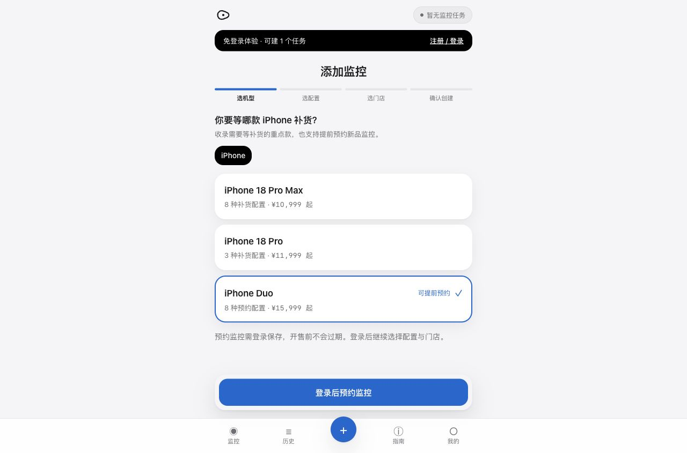

# 2026-10-12 生产发布记录

北京时间 2026-10-12 01:58:47 完成发布，站点：`https://stock.glint.red`。

应用提交：`bf82ffa54277650c9987c1c2a8b302fcbb2d8bf7`，已推送到 GitHub `master` 与 `codex/deploy-audit-fixes`。本记录是发布后的文档补充，不改变运行代码。

## 上线内容

- 精选补货目录：11 个有样本门店缺货证据的 iPhone 18 Pro / Pro Max 配置，8 个 iPhone Duo 预约配置。普通现货和其他品类没有全量导入。缺货依据只覆盖采样门店，不代表全国持续缺货。
- Duo 提前预约：使用现有单建／批量任务接口保存官方 SKU、门店及通知配置；要求登录，默认无到期时间。开售前等待，到官方预计预购时间后正常检查所选门店，实际可自提才按通知规则提醒。未开放自提、失败和未知不会触发。
- 库存查询和 Safari 修复、体验任务转入账号后的期限处理、状态说明与商品配置展示。
- 支付流程精简：仍使用爱发电；返回本站后自动核对权益，只接受已付款记录或实际升级作为确认依据。退款、金额异常、未知方案和降级不能显示付款成功。面包多文档仍是拟接入方案，没有替换实际收款渠道。
- 修正部署 rsync 的 data/logs 排除范围：保护后端根目录运行数据，同时正确同步 `app/data/apple_catalog.json`。

## 发布与回滚准备

先在独立目录构建并检查生产配置及 API 导入，再备份当前运行代码、静态资源、配置与一致性的 SQLite 数据库；随后短暂停止 API／引擎，同步后端并替换前台静态资源，再启动服务。本次没有数据库结构迁移，没有修改支付／邮件凭据及其他网站 nginx 配置。

服务器发布与备份目录：`/opt/stockmon/releases/20261012-bf82ffa`。部署元数据：`/opt/stockmon/deployed-release.json`。配置及数据库备份只保存在服务器，未提交 GitHub。切换脚本设置失败回滚到旧运行文件，数据库保持当前业务写入；本次部署成功，没有执行回滚。

## 已验证

- 本地后端 260 项测试通过；运行代码和本轮测试文件 Ruff 检查通过。
- 前端全部测试与生产构建通过；服务器对相同提交重新安装锁定依赖、运行前端测试和构建，产物与本地一致。
- 服务器新 API 可启动，商品快照和预约模块可导入，19 个条目校验通过。
- 公网 `/healthz`：数据库正常、独立引擎运行、API 内不启动第二引擎；已确认重启后写入的新心跳。
- 公网目录返回 19 个配置，其中 8 个带 Duo 预购时间及 `verification.status=scheduled`。
- 公网页面 HTML、JS 和 CSS 逐项与本次构建字节／SHA256 匹配；`/admin/` 返回 200。
- 浏览器确认添加监控页显示三个精选机型、Duo“可提前预约”及登录保存说明，未出现浏览器错误。
- 发布前后原有用户、任务、付款记录数量一致；未建立生产测试账号、未创建生产测试任务，也未执行付款或测试邮件。

开售时间边界、失败／未知不提醒及通知去重已由隔离数据库与模拟库存回归验证；本轮没有执行真实付款、退款或人工触发到货通知。官网快递下单开放检测仍不属于当前直营店自提库存链路。
